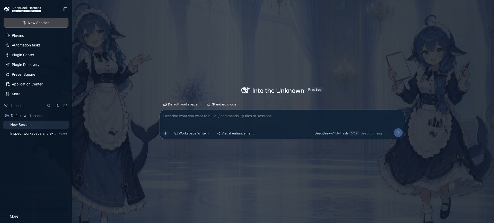
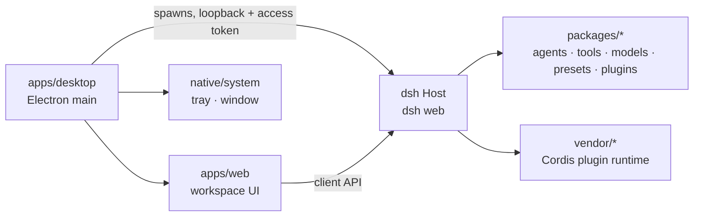

# DeepSeek Harness Desktop Plus

A desktop application for the DeepSeek Harness agent runtime. It starts and supervises a local
`dsh web` Host and puts plugin, preset, application, vision and local-model management in a
window, so using the runtime does not require a terminal.

**Project page: [aiengstore.com/projects/deepseek-harness-desktop](https://aiengstore.com/projects/deepseek-harness-desktop).**
This repository is the open-source version of the desktop shell and the code stays here. The project
page carries the write-up next to the rest of the collection.



## Quick start

Prerequisites:

- macOS 13+ or Windows 10/11. The desktop shell is built for these two platforms; the upstream
  `dsh` CLI and Web UI also run on Linux.
- Node.js `^22.19.0` or `>=24.0.0`.
- pnpm 11.28.5 through Corepack (`corepack enable`).
- Git 2.26 or newer.

```sh
corepack enable
pnpm install
pnpm dev:desktop
```

The first launch builds the host, client and desktop bundles with `tsc`/`tsdown` and then opens the
window; later launches rebuild only what changed.

What still needs separate configuration:

- Model access: put provider API keys in the app's Settings, or point a model provider at a local
  Ollama / vLLM / SGLang endpoint. No `.env` file is required.
- Installers: `pnpm run dist:mac` and `pnpm run dist:win` build signed packages and need the
  platform toolchain plus signing/notarization credentials. Development does not need them.

## What it does

- **Supervises the local Host.** Electron spawns `dsh web` on loopback with an access token, owns the
  tray, recovery and installer, and shuts the Host down with the window.
- **Plugin lifecycle from the UI.** Plugin Center and Plugin Discovery list the public catalog, show
  version, permissions and compatibility before install, and support enable, disable, update and
  uninstall. An unfinished transaction rolls back; a runtime whose plugin record disagrees enters a
  safe mode that still allows disabling or removing the plugin.
- **Preset Square and Application Center.** Browse and install agent presets with their Skills and
  tool requirements, and launch bundled applications such as the LLM Wiki in their own window.
- **Workspace and session management.** Open local projects with the native directory picker,
  organize and search sessions per workspace, and rename, archive, fork or resume them, with a
  full-conversation outline and full-text jump.
- **Approval gates for tool calls.** When a tool call needs consent, the composer is taken over by
  the pending request: it shows the exact call and the caller's reason, Enter allows it once, Escape
  rejects it, and every approval ask/answer pair is written to the session log. A session can also run under
  an `ask` (default) or `never` policy, and a request with no available answerer fails closed.
- **Settings-first configuration.** Vision enhancement, local model providers, skins and general
  preferences are configured in the interface instead of editing configuration files.

## Architecture



- `apps/desktop` is the Electron shell; `apps/web` is the browser workspace the Host serves;
  `apps/cli` is the `dsh` command the shell starts.
- `packages/*` holds the agent runtime and product surfaces; `vendor/*` holds the source-vendored
  Cordis runtime; `native/system` holds the tray/window addon.
- The integration tracks upstream DeepSeek Harness `0.2.1-rc.5`; the change history is in
  [UPSTREAM_0.2.1_INTEGRATION.md](UPSTREAM_0.2.1_INTEGRATION.md).

## License

MIT, see [LICENSE](LICENSE).

This repository contains and depends on third-party code: the upstream DeepSeek Harness runtime
(MIT), the vendored Cordis packages (MIT), and the dependencies listed in
[THIRD_PARTY_NOTICES.md](THIRD_PARTY_NOTICES.md). See [NOTICE](NOTICE) for attribution.
