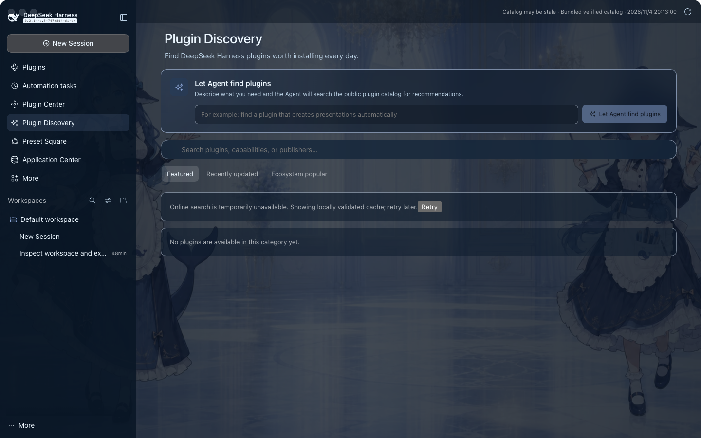
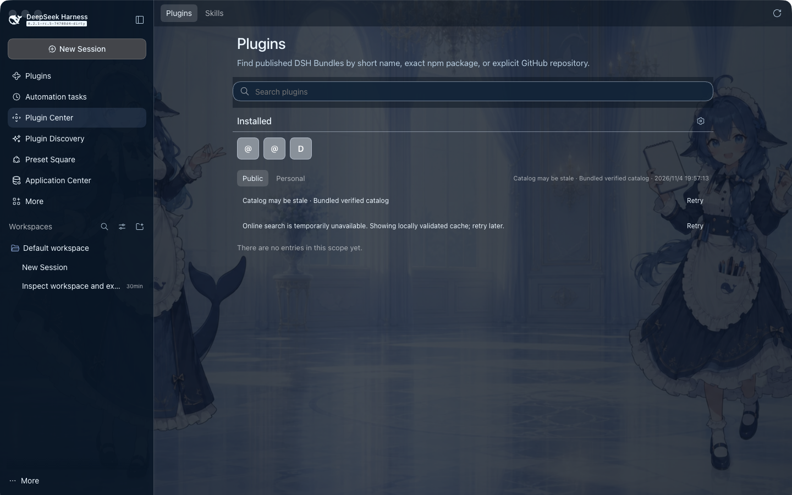
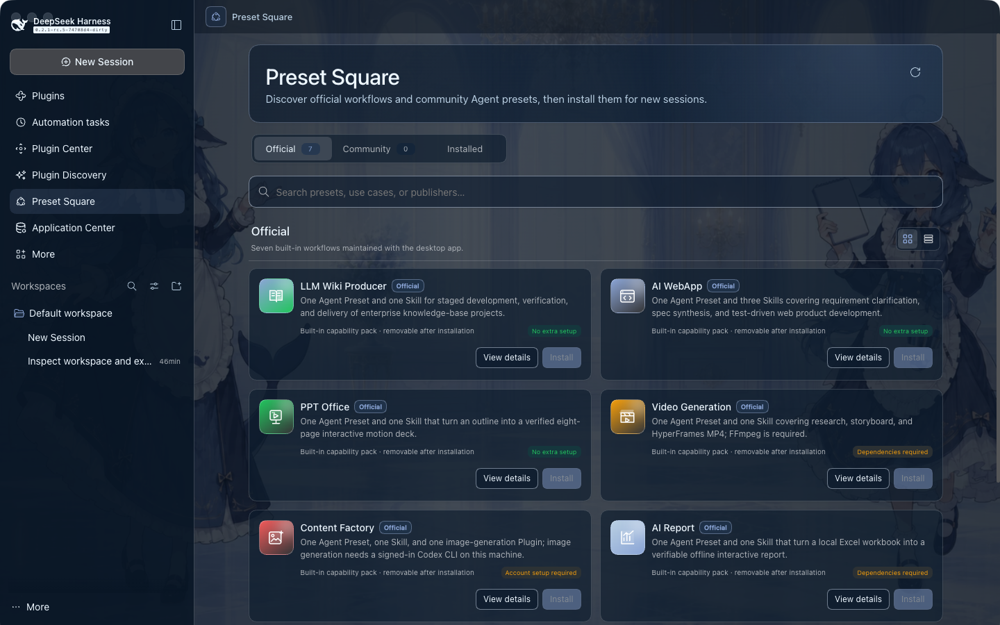
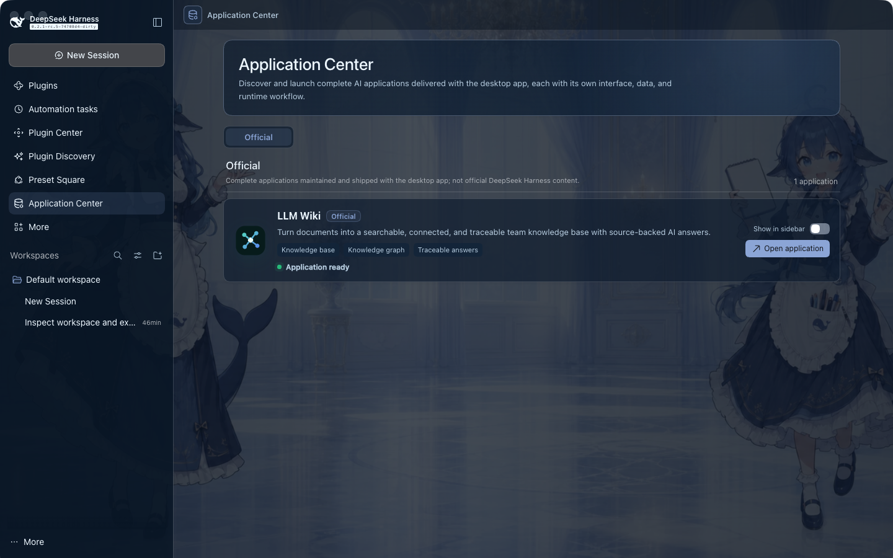
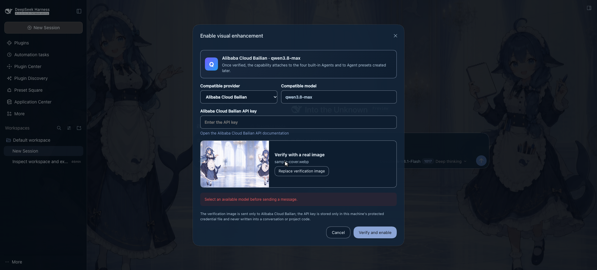
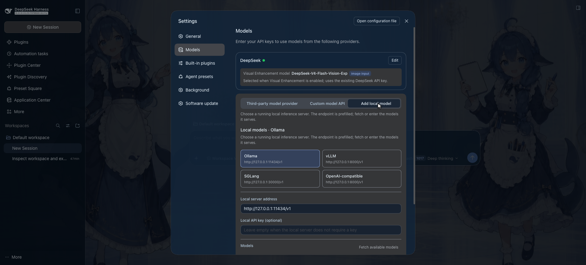
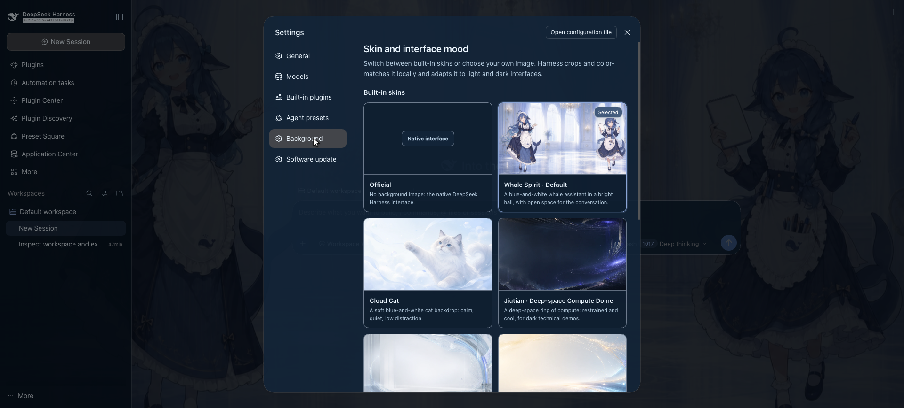
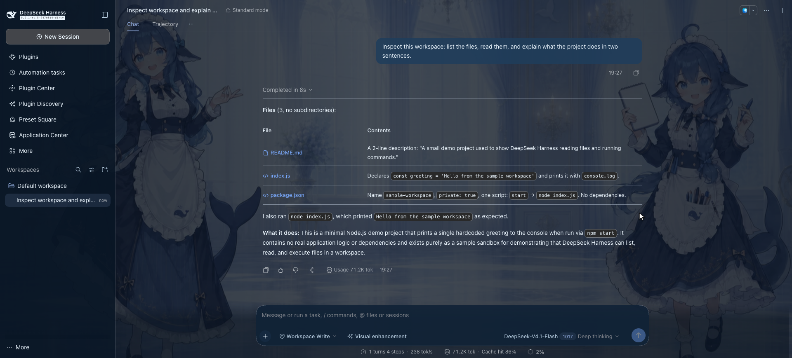
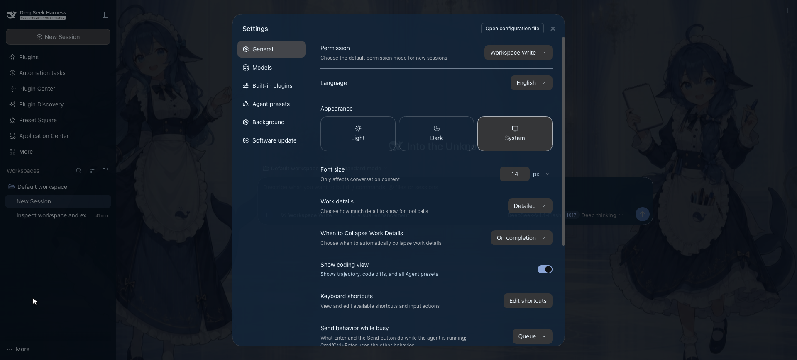
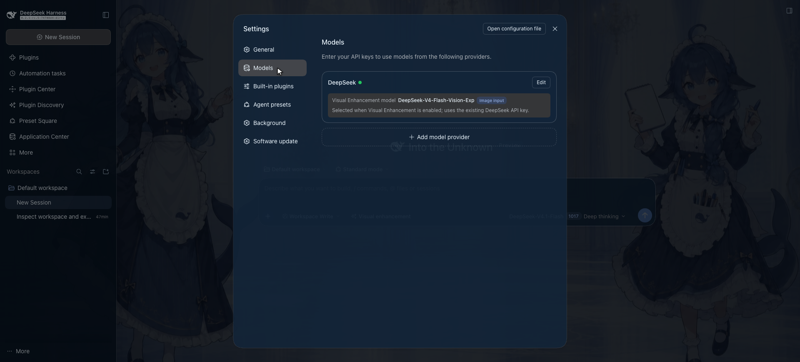

<h1 align="center">DeepSeek Harness Desktop Plus</h1>

<p align="center">
  
  
  
  
</p>

<p align="center"><strong>A desktop workspace for DeepSeek Harness — no terminal required.</strong></p>

<p align="center">Plugin Center · Plugin Discovery · Preset Square · Application Center · Vision Enhancement · Local models · Skins</p>

<p align="center">Search, verify, install, enable, and remove plugins from the interface. Launch complete AI applications next to your sessions. Connect DeepSeek or a local Ollama / vLLM / SGLang endpoint without editing a configuration file.</p>

<p align="center">
  
</p>

## What this is

[DeepSeek Harness](https://github.com/deepseek-ai/deepseek-harness) is a plugin-based agent runtime: agents and sessions, model adapters, tools, attachments, subagents, presets, bundles, and a browser workspace. It is powerful, and it expects you to compose it from a terminal.

This repository keeps that runtime intact and adds the product layer a desktop user expects:

- **A real desktop shell.** Electron starts and supervises a local `dsh web` Host, keeps it on loopback with an access token, owns the tray, recovery, and installer, and shuts the Host down with the window.
- **Product surfaces over the Harness client.** Plugin Center and Plugin Discovery, Preset Square, Application Center, Vision Enhancement, local model providers, and skins — all reachable from the sidebar, no command line.
- **A second path to new capabilities.** Instead of learning the plugin protocol, a user browses a verified catalog, reads what a plugin asks for, and installs it in one step; unfinished transactions roll back, and a runtime whose plugin record disagrees enters a safe mode that still lets the user disable or remove the plugin.
- **Applications, not only chats.** The bundled LLM Wiki turns documents into a searchable, connected knowledge base and opens as its own application with its own data and interface.

It tracks upstream `dsh 0.2.1-rc.5`. The desktop application carries its own version (`apps/desktop`, currently `0.1.0-rc.19`); the integration history is in [UPSTREAM_0.2.1_INTEGRATION.md](UPSTREAM_0.2.1_INTEGRATION.md).

## Features

Each capability below exists in source, is part of the desktop composition, and is reachable from the user interface.

| Capability | What it enables |
| --- | --- |
| **Desktop workspaces and sessions** | Open local projects through the native directory picker, organize and search sessions per workspace, and rename, archive, fork, or resume a session. |
| **Long-session outline and full-text jump** | Build a complete outline of a conversation by user, assistant, and tool turns; jumping to an entry loads older messages that were not rendered yet and highlights the matching text. |
| **Plugin discovery and Agent shortlisting** | Browse featured, recently updated, and ecosystem-popular plugins, filter by scenario, or describe a need and let the Agent shortlist candidates from the public `dsh-plugin` catalog. |
| **Trusted plugin lifecycle** | Review exact version, permissions, compatibility, and risk before installation; enable, disable, update, or uninstall afterwards; an unfinished transaction rolls back, and a runtime whose plugin record disagrees enters a safe mode that still allows disabling and uninstalling. |
| **Preset Square** | Browse built-in and community Agent Presets with their Skills, tools, and environment requirements, keep the installed list usable, and start new sessions from an installed Preset. |
| **Application Center and LLM Wiki** | Launch complete AI applications that own their interface, data, and runtime flow from a first-class entry, with an optional sidebar shortcut. The first bundled application is the LLM Wiki knowledge base. |
| **Providers and local inference** | Configure DeepSeek and other compatible providers, or connect Ollama, vLLM, SGLang, and custom OpenAI-compatible services from one entry. |
| **Native and compatible vision** | Let an image-capable DeepSeek model read images directly, or route images through a verified compatible vision provider; image attachments are stored durably and travel one path into model context. |
| **Plan, Goal, Todo, Jobs, and Workflow** | Enter plan mode, manage goals and todos, inspect background jobs owned by the current process, and review multi-stage Workflow runs in the conversation. |
| **Subagents and multi-agent sessions** | Start one-shot or continuable subagents, inspect the parent/child session lineage, status, and elapsed time, and continue or stop a child turn where supported. |
| **Project rules, context references, and artifacts** | Read repository instructions, reference context with `@file` and `@session`, and open or reveal the files an Agent actually produced. |
| **Permissions, sandbox, and approvals** | Choose read-only, workspace-write, or full access for the current or future sessions; dangerous permissions, tool approvals, and Agent questions are confirmed explicitly in the interface. |
| **Skins and themes** | Switch between bundled skins, local backgrounds, and the default theme, with interface colors adapting automatically. |
| **Cross-platform desktop delivery** | Build macOS arm64 and Windows x64 desktop packages locally with electron-builder. |

## Screenshots


Desktop workspace and sessions.



Plugin discovery with Agent shortlisting.



Plugin center: verification, installation, enablement, and removal.



Preset Square with built-in and community Agent Presets.



Application Center and the bundled LLM Wiki application.



Vision enhancement settings and the input-area shortcut.



Local model providers: Ollama, vLLM, SGLang, and custom OpenAI-compatible services.



Skins, backgrounds, and theme adaptation.

### More screens



A session running tools against the workspace, with the step timeline and usage counters.



General settings: permission mode, language, appearance, work-detail level, and shortcuts.



Model providers and the built-in DeepSeek provider, including the visual-enhancement model.

## How it fits together

The desktop application is a shell around the real Harness runtime, not a second implementation of it.

```text
┌─────────────────────────────────────────────────────────────┐
│ Electron main process                                       │
│  tray · window · native dialogs · installer · recovery      │
│                                                             │
│  ┌───────────────────────────────────────────────────────┐  │
│  │ `dsh web` Host (child process, 127.0.0.1, token URL)  │  │
│  │  agent loop · sessions · tools · plugins · presets    │  │
│  └───────────────────────────────────────────────────────┘  │
│                          ▲                                  │
│                          │ IPC bridge (fixed contract)      │
│  ┌───────────────────────┴───────────────────────────────┐  │
│  │ Browser renderer (the same web workspace upstream)    │  │
│  └───────────────────────────────────────────────────────┘  │
└─────────────────────────────────────────────────────────────┘
```

- The Host is a normal Harness process. The desktop shell reads its readiness line, opens the window on the authenticated URL, and forwards a small, fixed set of desktop operations over IPC (catalog, plugin operations, presets, appearance, updates).
- Profiles, plugins, settings, and session data live under `DSH_HOME`; the desktop application never rewrites user credentials or session history.
- The product surfaces are ordinary client plugins. They mount into the same sidebar and conversation slots as upstream plugins, so an upstream upgrade does not require a fork of the shell.

## Getting started

### Requirements

- Node.js `^22.19.0 || >=24.0.0`.
- pnpm `11.28.5`; `corepack enable` selects the version pinned in `package.json`.
- macOS or Windows for the desktop application. The browser interface and the Harness runtime also run on Linux.

<a id="run"></a><a id="run-from-source"></a>

### Install and run from source

```sh
git clone <this-repository-url>
cd deepseek-harness-desktop-plus
pnpm install
```

Installing dependencies, building, and launching the desktop development environment need no API key. Configure credentials only when a model or vision request is made, and never commit them.

### Build

```sh
pnpm run build
```

This builds the Host and client artifacts and then the desktop application.

### Run the browser interface

`dsh web` serves the built browser interface and prints a URL that carries an access token:

```sh
pnpm dsh web
```

Useful flags: `--port <port>` where `0` lets the operating system pick a free port, `--host <address>`, `--no-open` to skip opening the default browser, and `--tls-cert` with `--tls-key` for HTTPS. Run `pnpm dsh web --help` for the full list.

For a development loop that rebuilds browser-side artifacts on every edit and then serves them, run:

```sh
pnpm run dev:web
```

### Run the desktop application

```sh
pnpm run dev:desktop
```

The launcher rebuilds the workspace outputs whose inputs changed, projects the built CLI and desktop Host packages into a disposable runtime, uses an isolated Harness home, and starts Electron. Later launches reuse the existing build until an input changes.

### Package the desktop application

```sh
pnpm run dist:desktop:mac   # macOS arm64 package
pnpm run dist:desktop:win   # Windows x64 installer
```

Both commands run electron-builder after the workspace build; artifacts land under `apps/desktop/dist`.

### Environment variables

All variables are optional. The values below are examples; never commit real credentials.

| Variable | Purpose |
| --- | --- |
| `DEEPSEEK_API_KEY` | Credential reference that the shipped provider routes resolve for DeepSeek requests. It can also be stored through the application credential surface instead of the environment. |
| `OPENROUTER_API_KEY` | Credential used by the optional OpenRouter vision route when compatible vision is enabled. Other compatible vision providers use their own stored credentials. |
| `DSH_HOME` | Overrides the Harness home directory that holds profiles, plugins, settings, and session data. Defaults to `~/.dsh`. |

## Repository layout

```text
deepseek-harness-desktop-plus/
├── apps/
│   ├── desktop/       # Electron main process, preload, Host supervisor, packaging and release scripts
│   ├── web/           # Browser entry and the desktop web composition
│   └── cli/           # `dsh` CLI, runtime configuration, and profiles
├── packages/          # Agent, model, tool, session, plugin, attachment, and client packages
├── native/            # Native sandbox helpers
├── scripts/           # Build, generation, verification, and release scripts
├── website/           # Documentation site source
├── vendor/            # Pinned Cordis foundation source
└── assets/            # Images used by this README
```

## Common commands

| Command | Purpose |
| --- | --- |
| `pnpm install` | Install workspace dependencies. |
| `pnpm run build` | Build Host and client artifacts, then the desktop application. |
| `pnpm run build:desktop` | Build only the desktop application. |
| `pnpm run dev:web` | Build artifacts once, watch browser-side sources, and serve with `dsh web`. |
| `pnpm run dev:desktop` | Launch the Electron desktop application from workspace outputs. |
| `pnpm dsh web` | Serve the browser interface from the current build. |
| `pnpm run dist:desktop:mac` / `pnpm run dist:desktop:win` | Create a platform package with electron-builder. |
| `pnpm run typecheck` | Run the TypeScript typecheck gates. |
| `pnpm run test` | Run the Vitest unit suite. |
| `pnpm run check:all` | Run the repository quality gates. |

## Suggested reading order

1. `apps/desktop/src/main.ts` — desktop entry, window, tray, and local Host composition.
2. `apps/desktop/src/host-supervisor.ts` — `dsh web` startup, readiness detection, and shutdown.
3. `apps/desktop/src/preload.ts` — the fixed desktop interfaces exposed to the renderer.
4. `apps/web/` — the web workspace the desktop window loads.
5. `apps/cli/` and `packages/` — CLI composition and the Harness capability packages.
6. [docs/architecture.md](docs/architecture.md) — how the runtime, plugins, and capability seams fit together.

## Known limitations

1. **Preset installation is unavailable.** A preset directory from the `0.1.1` line and a `0.2.1` profile patch composition are not the same model. Browsing, previewing, deleting, and using an already installed Preset work; installing returns a typed `preset/install-unavailable` result and the interface states that installation is not supported.
2. **Upstream-only applications are not packaged.** `apps/desktop-host` and `apps/plugin-market-generator` remain in the workspace for the upstream composition, and the desktop build does not package them.
3. **No online auto-update.** Desktop delivery uses repository release artifacts; in-application update delivery is not part of this build.

## Upstream and license status

This project is based on [DeepSeek Harness](https://github.com/deepseek-ai/deepseek-harness) and continues its runtime, plugin system, and web interface inside a desktop product. The upgrade history and upstream ownership boundary are recorded in [UPSTREAM_0.2.1_INTEGRATION.md](UPSTREAM_0.2.1_INTEGRATION.md).

This repository is a private product build and is not open source. It contains components of DeepSeek Harness, whose original copyright notices and licenses are preserved in [THIRD_PARTY/DeepSeek-Harness-LICENSE.txt](THIRD_PARTY/DeepSeek-Harness-LICENSE.txt) and [THIRD_PARTY_NOTICES.md](THIRD_PARTY_NOTICES.md). Brand usage guidance is in [BRAND_GUIDELINES.md](BRAND_GUIDELINES.md).
